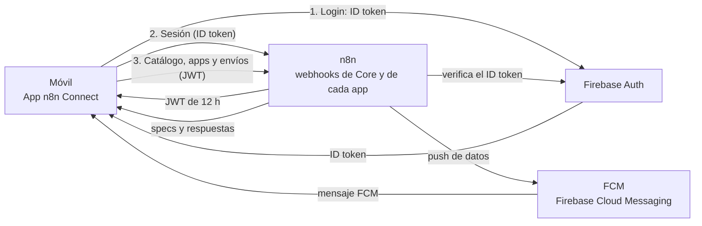

<p align="center"></p>

<h1 align="center">n8n Connect</h1>

<p align="center">
  App Android para usar en el móvil las apps que diseñas con flujos de <a href="https://n8n.io">n8n</a>.
</p>

<p align="center">
  <a href="https://github.com/BiliBC034/n8n_connect/actions/workflows/ci.yml"></a>
  <a href="LICENSE"></a>
  
  
  <a href="https://github.com/BiliBC034/n8n_connect/releases/latest"></a>
</p>

> **Estado:** en desarrollo. Solo Android por ahora.

## Qué es y por qué

n8n Connect conecta tu servidor de n8n con tu móvil. La APK es fija: no hace falta publicar una versión nueva de la app para crear otra. Las apps se diseñan en n8n como un JSON (la *spec*) con pantallas, formularios, botones y listas, y aparecen en el móvil. Cuando pulsas un botón, la app envía los datos a n8n y n8n responde con lo que hay que mostrar o hacer.

- **Apps sin recompilar**: pantallas y lógica viven en n8n.
- **n8n actúa en el móvil**: puede poner alarmas, crear eventos de calendario, mostrar notificaciones, abrir enlaces o mapas, etc.
- **Avisos con acciones**: n8n puede enviar un push que lanza acciones aunque la app esté cerrada.
- **Automatizaciones**: si lo permites en cada app, n8n puede ejecutar acciones sin preguntar, por ejemplo programar una alarma según tu agenda y tu ubicación.

## Funciones

- **Inicio de sesión** con Firebase: email y contraseña (con verificación de email) o Google.
- **Sesión firmada con tu servidor**: la app cambia el token de Firebase por una sesión de 12 h emitida por n8n y la renueva sola.
- **Conexión con n8n**: guardas la URL de tu servidor (solo HTTPS) y la app comprueba que es un servidor n8n Connect.
- **Catálogo de apps**: las apps publicadas en n8n aparecen en la pantalla principal.
- **Specs de UI declarativas**: textos, formularios, selectores, deslizadores, tarjetas, listas, indicadores, cuadrículas y tablas, con plantillas `{{clave}}`.
- **Acciones del dispositivo**: alarmas, temporizadores, calendario, enlaces, mapas, llamadas, SMS, correo, compartir, portapapeles, vibración, notificaciones, ajustes del sistema y apertura de otras apps.
- **Push con acciones**: n8n pide confirmación o, si lo activas en Configuración, ejecuta las acciones sin preguntar.
- **Automatizaciones con permiso por app**: cada app puede ejecutar sus acciones automáticas sin preguntar. Se revoca en Configuración → Automatizaciones.
- **Alarmas propias de n8n**: suenan con la app cerrada, sobreviven a reinicios y se pueden posponer 5 minutos.
- **Datos del móvil para n8n**: ubicación y zona horaria, solo con permiso (por ejemplo, para calcular tiempos de viaje).
- **Permisos desde las apps**: un componente para ver y pedir ubicación o notificaciones.
- **Bandeja de n8n**: historial de los pushes recibidos, con su estado y un botón para volver a ejecutarlos.
- **Compartir con n8n**: envía texto o enlaces desde cualquier app a n8n, con una nota opcional.
- **Paneles en vivo**: las apps con `refreshSeconds` se recargan solas mientras están en pantalla.
- **Modo sin conexión**: sin red, el catálogo y las apps muestran la última copia guardada.
- **Tutorial** la primera vez que abres la app (se puede repetir desde Configuración).
- Idioma español o inglés, y tema claro u oscuro.

## Cómo funciona



1. La app inicia sesión con Firebase Auth y obtiene un ID token.
2. La app envía ese token a n8n. n8n lo verifica con Google, comprueba que el email esté verificado y habilitado, y devuelve un JWT de 12 h.
3. Con ese JWT, la app pide el catálogo y la spec de cada app, y envía los formularios y botones a los webhooks de la app.
4. Para avisar al móvil, n8n envía un mensaje de datos por FCM. La app muestra un diálogo o una notificación y ejecuta las acciones según el caso.

Detalles en [docs/PROTOCOL.md](docs/PROTOCOL.md) (§1 visión general y §2 seguridad).

## Descargar

Descarga la última APK desde [las releases](https://github.com/BiliBC034/n8n_connect/releases/latest): `n8n-connect-vX.Y.Z.apk`, con su `.sha256` para comprobar la descarga. Requiere Android 7.0 o superior.

> **Nota:** la APK publicada está compilada con el proyecto Firebase del autor y solo se conecta a servidores n8n configurados con ese mismo proyecto (con otro, la app rechaza la conexión con `wrong_firebase_project`). Para tu propio servidor, compila la app con tu propio Firebase (ver [Puesta en marcha](#puesta-en-marcha)).

Para publicar tus propias versiones firmadas, sigue [docs/RELEASING.md](docs/RELEASING.md).

## Puesta en marcha

Requisitos: Flutter 3.35 (Dart 3.9), Android SDK y un móvil o emulador Android.

1. **Proyecto Firebase.** En la [consola de Firebase](https://console.firebase.google.com/):
   - Crea un proyecto y activa **Authentication** con los proveedores *Correo electrónico/contraseña* y *Google*.
   - Registra una app Android con el paquete `me.bilibc.n8n_connect`. Añade la huella SHA-1 de tu clave de firma (debug: `cd android && ./gradlew signingReport`), necesaria para Google Sign-In, y después descarga su `google-services.json`.
   - Crea una cuenta de servicio para que n8n envíe los push (ver el paso siguiente).

2. **Servidor n8n.** Sigue [n8n/README.md](n8n/README.md). Crea las tablas según `n8n/data-tables.json` (n8n no las importa: se crean en la UI o con el MCP), importa `n8n/workflows/` y sustituye todos los `REPLACE_…` (IDs de credenciales, tablas y sub-workflows, Web API key, ID del proyecto y nombre del servidor; lista completa en [n8n/README.md](n8n/README.md)). Configura las credenciales que piden los nodos.

3. **Compila la app.** Copia los archivos de ejemplo a sus nombres reales (o usa `flutterfire configure` para generar `lib/firebase_options.dart`):

   ```bash
   cp lib/firebase_options.example.dart lib/firebase_options.dart
   cp lib/firebase_web_client.example.dart lib/firebase_web_client.dart
   cp android/app/google-services.example.json android/app/google-services.json
   ```

   Sustituye los valores de ejemplo por los de tu proyecto, usando el `google-services.json` que descargaste. Esos archivos contienen datos de Firebase y están en `.gitignore`: no los subas al repositorio.

   ```bash
   flutter pub get
   flutter build apk --release
   ```

   Para firmar la release con tu propia clave, crea `android/key.properties` como se explica en [docs/RELEASING.md](docs/RELEASING.md). Sin ese archivo, Gradle usa la clave debug y avisa.

4. **Primer inicio.**
   1. En la tabla `nc_users` de n8n, añade tu email en minúsculas con `enabled = true` y el `role` que quieras. Sin esa fila, el servidor rechaza la cuenta (`not_allowed`).
   2. Abre la app (verás un tutorial), inicia sesión, verifica tu email si te lo pide y escribe la URL de tu servidor (por ejemplo, `https://n8n.tu-dominio.com`; la app quita rutas como `/webhook` o `/home`).

## Crear tus propias apps

Una app es un webhook GET que devuelve su spec en JSON, más los webhooks que reciben sus botones (*submit*). Para mostrarla en el catálogo, añade una fila en la tabla `nc_apps`.

- Empieza por la plantilla [n8n/workflows/app-tools.json](n8n/workflows/app-tools.json), la app de demostración con componentes y acciones del dispositivo.
- Guía paso a paso en [docs/PROTOCOL.md §5](docs/PROTOCOL.md#5-cómo-crear-una-app). Spec de UI en [§6](docs/PROTOCOL.md#6-spec-de-ui-schema-1) y acciones en [§7](docs/PROTOCOL.md#7-acciones).
- El repositorio está preparado para trabajar con agentes de IA. Sus directrices están en [AGENTS.md](AGENTS.md).

## Seguridad

- **Solo HTTPS**: la app no acepta servidores `http://` ni tráfico en claro.
- **Sesión verificada**: n8n comprueba el token de Firebase con Google, exige email verificado y que la cuenta esté habilitada en `nc_users`.
- **JWT de corta duración**: 12 h, renovado automáticamente. Los webhooks de las apps deben exigir ese JWT (las plantillas lo hacen).
- **Acceso por app**: cada app debe comprobar el acceso con el sub-workflow «n8n Connect · Acceso a app» ([n8n/workflows/app-access.json](n8n/workflows/app-access.json)). Si una app no hace esa comprobación, `allowed_emails` de `nc_apps` solo filtra el catálogo.
- **Almacenamiento**: la sesión va en almacenamiento cifrado respaldado por el Keystore de Android. La copia offline, la bandeja y los permisos de automatización van sin cifrar y nunca contienen el JWT ni el token de Firebase.
- **Mismo origen**: una spec no puede enviar el JWT a otro dominio.
- **Validación en el servidor**: los campos `required` de una spec solo sirven para la interfaz; n8n debe validar siempre lo que recibe.

Modelo completo en [docs/PROTOCOL.md §2](docs/PROTOCOL.md#2-seguridad). Para reportar una vulnerabilidad, consulta [SECURITY.md](SECURITY.md).

## Desarrollo

```bash
flutter pub get                      # instala dependencias
dart format lib test                 # formatea el código
flutter analyze                      # análisis estático (sin avisos)
flutter test                         # tests unitarios
dart run intl_utils:generate         # regenera lib/generated/ desde lib/l10n/*.arb (traducciones)
flutter build apk --release          # APK de release
```

Los textos están en `lib/l10n/` (español e inglés). Tras editarlos, ejecuta `dart run intl_utils:generate`. No edites `lib/generated/` a mano.

Estructura del repositorio:

```
lib/
├── main.dart, app.dart      Arranque, MaterialApp y manejo de push
├── core/                    Rutas, plantillas {{clave}} y utilidades del protocolo
├── features/                Una carpeta por área: actions, alarms, apps, auth, automation,
│                            device_context, onboarding (tutorial), push, server, settings, share, startup
├── l10n/                    Textos en español e inglés (.arb)
└── generated/               Traducciones generadas
android/                     Proyecto Android (permisos, notificaciones, MainActivity)
assets/branding/             Logo
docs/PROTOCOL.md             Protocolo entre la app y n8n
n8n/                         Plantillas de workflows y tablas para n8n
test/                        Tests unitarios
tools/send_push.py           Envía un push de prueba sin pasar por n8n
```

## Probar un push con tools/send_push.py

Envía un mensaje FCM de datos directamente a un móvil, sin pasar por n8n. Sirve para probar acciones, diálogos y notificaciones.

Requisitos:

```bash
pip install firebase-admin
```

Credenciales: una cuenta de servicio del proyecto Firebase (archivo JSON). Pásala con `--service-account` o con la variable `GOOGLE_APPLICATION_CREDENTIALS`. No la subas al repositorio.

Token: el token FCM del dispositivo está en la fila de `nc_devices` (campo `fcm_token`).

| Argumento | Obligatorio | Por defecto | Descripción |
|---|---|---|---|
| `--service-account` | no (si hay `GOOGLE_APPLICATION_CREDENTIALS`) | — | Ruta al JSON de la cuenta de servicio |
| `--token` | sí | — | Token FCM del dispositivo destino |
| `--title` | no | `n8n Connect` | Título |
| `--body` | no | vacío | Cuerpo |
| `--actions` | no | `[]` | Lista JSON de acciones, p. ej. `'[{"type":"set_alarm","hour":7,"minute":30,"label":"Prueba"}]'` |
| `--app` | no | vacío | Id de la app asociada |

Ejemplos:

```bash
# Alarma a las 07:30 (en primer plano pide confirmación; en segundo plano muestra el botón "Ejecutar")
python3 tools/send_push.py --service-account /ruta/cuenta-servicio.json --token TOKEN_FCM \
  --title "Alarma" --body "07:30" \
  --actions '[{"type":"set_alarm","hour":7,"minute":30,"label":"Prueba"}]' --app tools

# Aviso simple de una app
python3 tools/send_push.py --service-account /ruta/cuenta-servicio.json --token TOKEN_FCM \
  --title "Hola" --body "Prueba desde el PC" --app hola
```

El script imprime el id del mensaje si FCM lo acepta. Si no, muestra el error de FCM.

## Documentación

- [docs/PROTOCOL.md](docs/PROTOCOL.md): protocolo completo entre la app y n8n (endpoints, seguridad, tablas, spec de UI, acciones, push, automatizaciones y ejemplos).
- [n8n/README.md](n8n/README.md): puesta en marcha del servidor n8n.
- [AGENTS.md](AGENTS.md): directrices para agentes de IA.
- [CONTRIBUTING.md](CONTRIBUTING.md): cómo preparar el entorno y enviar cambios.
- [docs/RELEASING.md](docs/RELEASING.md): cómo firmar la APK y publicar una versión en GitHub Releases.
- [CHANGELOG.md](CHANGELOG.md): cambios de cada versión.
- [SECURITY.md](SECURITY.md): política de seguridad y cómo reportar vulnerabilidades.

## Licencia

Distribuido bajo la licencia MIT. Ver [LICENSE](LICENSE).
