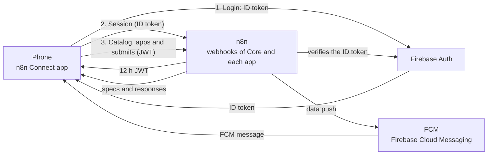

<p align="center"></p>

<h1 align="center">n8n Connect</h1>

<p align="center">
  Android app for using on your phone the apps you design with <a href="https://n8n.io">n8n</a> workflows.
</p>

<p align="center">
  <a href="https://github.com/BiliBC034/n8n_connect/actions/workflows/ci.yml"></a>
  <a href="LICENSE"></a>
  
  
  <a href="https://github.com/BiliBC034/n8n_connect/releases/latest"></a>
</p>

> **Status:** in development. Android only for now.

## What it is and why

n8n Connect connects your n8n server with your phone. The APK is fixed: there is no need to publish a new version of the app to create another one. Apps are designed in n8n as a JSON file (the *spec*) with screens, forms, buttons and lists, and they appear on the phone. When you tap a button, the app sends the data to n8n, and n8n responds with what to show or do.

- **Apps without rebuilding**: screens and logic live in n8n.
- **n8n acts on the phone**: it can set alarms, create calendar events, show notifications, open links or maps, etc.
- **Notices with actions**: n8n can send a push that runs actions even when the app is closed.
- **Automations**: if you allow it in each app, n8n can run actions without asking, for example scheduling an alarm based on your calendar and location.

## Features

- **Sign-in** with Firebase: email and password (with email verification) or Google.
- **Session signed by your server**: the app exchanges the Firebase token for a 12 h session issued by n8n, and renews it automatically.
- **Connection to n8n**: you save your server URL (HTTPS only), and the app checks that it is an n8n Connect server.
- **App catalog**: the apps published in n8n appear on the home screen.
- **Declarative UI specs**: text, forms, selectors, sliders, cards, lists, indicators, grids and tables, with `{{key}}` templates.
- **Phone actions**: alarms, timers, calendar, links, maps, calls, SMS, email, sharing, clipboard, vibration, notifications, system settings and opening other apps.
- **Push with actions**: n8n asks for confirmation or, if you enable it in Settings, runs the actions without asking.
- **Automations with per-app permission**: each app can run its automatic actions without asking. Revoke it in Settings → Automations.
- **n8n's own alarms**: they ring with the app closed, survive reboots and can be snoozed for 5 minutes.
- **Phone data for n8n**: location and time zone, only with permission (for example, to calculate travel times).
- **Permissions from apps**: a component to view and request location or notification permissions.
- **n8n inbox**: history of the pushes received, with their status and a button to run them again.
- **Sharing with n8n**: send text or links from any app to n8n, with an optional note.
- **Live dashboards**: apps with `refreshSeconds` reload automatically while they are on screen.
- **Offline mode**: without a network, the catalog and apps show the last saved copy.
- **Tutorial** the first time you open the app (you can replay it from Settings).
- Spanish or English language, and light or dark theme.

## How it works



1. The app signs in with Firebase Auth and gets an ID token.
2. The app sends that token to n8n. n8n verifies it with Google, checks that the email is verified and enabled, and returns a 12 h JWT.
3. With that JWT, the app requests the catalog and each app's spec, and sends forms and buttons to the app's webhooks.
4. To notify the phone, n8n sends a data message through FCM. The app shows a dialog or a notification and runs the actions as appropriate.

Details in [docs/PROTOCOL.md](docs/PROTOCOL.md) (§1 overview and §2 security).

## Download

Download the latest APK from [the latest release](https://github.com/BiliBC034/n8n_connect/releases/latest): `n8n-connect-vX.Y.Z.apk`, along with its `.sha256` to verify the download. Requires Android 7.0 or later.

Tester builds can also be distributed through Firebase App Distribution. See [docs/RELEASING.md](docs/RELEASING.md#h-distributing-to-testers-firebase-app-distribution).

> **Note:** the published APK is built with the author's Firebase project and only connects to n8n servers configured with that same project (with another one, the app rejects the connection with `wrong_firebase_project`). For your own server, build the app with your own Firebase (see [Getting started](#getting-started)).

To publish your own signed versions, follow [docs/RELEASING.md](docs/RELEASING.md).

## Getting started

Requirements: Flutter 3.35 (Dart 3.9), Android SDK, and an Android phone or emulator.

1. **Firebase project.** In the [Firebase console](https://console.firebase.google.com/):
   - Create a project and enable **Authentication** with the *Email/Password* and *Google* providers.
   - Register an Android app with the package `me.bilibc.n8n_connect`. Add the SHA-1 fingerprint of your signing key (debug: `cd android && ./gradlew signingReport`), which is required for Google Sign-In, and then download its `google-services.json`.
   - Create a service account so n8n can send the pushes (see the next step).

2. **n8n server.** Follow [n8n/README.md](n8n/README.md). Create the tables from `n8n/data-tables.json` (n8n does not import them: create them in the UI or with the MCP), import `n8n/workflows/`, and replace all the `REPLACE_…` placeholders (credential, table and sub-workflow IDs, web API key, project ID and server name; full list in [n8n/README.md](n8n/README.md)). Configure the credentials the nodes ask for.

3. **Build the app.** Copy the example files to their real names (or use `flutterfire configure` to generate `lib/firebase_options.dart`):

   ```bash
   cp lib/firebase_options.example.dart lib/firebase_options.dart
   cp lib/firebase_web_client.example.dart lib/firebase_web_client.dart
   cp android/app/google-services.example.json android/app/google-services.json
   ```

   Replace the example values with those of your project, using the `google-services.json` you downloaded. These files contain Firebase data and are listed in `.gitignore`: do not commit them to the repository.

   ```bash
   flutter pub get
   flutter build apk --release
   ```

   To sign the release with your own key, create `android/key.properties` as explained in [docs/RELEASING.md](docs/RELEASING.md). Without that file, Gradle uses the debug key and shows a warning.

4. **First start.**
   1. In the `nc_users` table in n8n, add your email in lowercase with `enabled = true` and the `role` you want. Without that row, the server rejects the account (`not_allowed`).
   2. Open the app (you will see a tutorial), sign in, verify your email if asked, and enter your server URL (for example, `https://n8n.your-domain.com`; the app strips paths such as `/webhook` or `/home`).

## Building your own apps

An app is a GET webhook that returns its spec as JSON, plus the webhooks that receive its buttons (*submit*). To show it in the catalog, add a row to the `nc_apps` table.

- Start from the template [n8n/workflows/app-tools.json](n8n/workflows/app-tools.json), the demo app with components and phone actions.
- Step-by-step guide in [docs/PROTOCOL.md §5](docs/PROTOCOL.md#5-how-to-create-an-app). UI spec in [§6](docs/PROTOCOL.md#6-ui-spec-schema-1) and actions in [§7](docs/PROTOCOL.md#7-actions).
- The repository is set up to work with AI agents. Their guidelines are in [AGENTS.md](AGENTS.md).

## Security

- **HTTPS only**: the app does not accept `http://` servers or cleartext traffic.
- **Verified session**: n8n checks the Firebase token with Google, requires a verified email, and requires the account to be enabled in `nc_users`.
- **Short-lived JWT**: 12 h, renewed automatically. App webhooks must require that JWT (the templates do this).
- **Per-app access**: each app must check access with the sub-workflow "n8n Connect · App access" ([n8n/workflows/app-access.json](n8n/workflows/app-access.json)). If an app does not run that check, `allowed_emails` in `nc_apps` only filters the catalog.
- **Storage**: the session is kept in encrypted storage backed by the Android Keystore. The offline copy, the inbox and the automation permissions are stored unencrypted, and they never contain the JWT or the Firebase token.
- **Same origin**: a spec cannot send the JWT to another domain.
- **Server-side validation**: the `required` fields in a spec are for the UI only; n8n must always validate what it receives.

The full model is in [docs/PROTOCOL.md §2](docs/PROTOCOL.md#2-security). To report a vulnerability, see [SECURITY.md](SECURITY.md).

## Development

```bash
flutter pub get                      # install dependencies
dart format lib test                 # format the code
flutter analyze                      # static analysis (no warnings)
flutter test                         # unit tests
dart run intl_utils:generate         # regenerate lib/generated/ from lib/l10n/*.arb (translations)
flutter build apk --release          # release APK
```

The app's strings are in `lib/l10n/` (Spanish and English). After editing them, run `dart run intl_utils:generate`. Do not edit `lib/generated/` by hand.

To send a build to testers through Firebase App Distribution, see [distributing to testers](docs/RELEASING.md#h-distributing-to-testers-firebase-app-distribution).

Repository structure:

```
lib/
├── main.dart, app.dart      Startup, MaterialApp and push handling
├── core/                    Routes, {{key}} templates and protocol utilities
├── features/                One folder per area: actions, alarms, apps, auth, automation,
│                            device_context, onboarding (tutorial), push, server, settings, share, startup
├── l10n/                    Strings in Spanish and English (.arb)
└── generated/               Generated translations
android/                     Android project (permissions, notifications, MainActivity)
assets/branding/             Logo
docs/PROTOCOL.md             Protocol between the app and n8n
n8n/                         Workflow templates and tables for n8n
test/                        Unit tests
tools/build_release.sh       Builds the release APK, its .sha256 and the release notes
tools/changelog_section.sh   Prints the CHANGELOG notes of a version
tools/distribute.sh          Sends a build to Firebase App Distribution (testers)
tools/release_secrets.sh     Prints or uploads the release secrets to GitHub
tools/send_push.py           Sends a test push without going through n8n
tools/verify_apk_signature.sh  Checks the APK signature (fails with the debug key)
```

## Testing a push with tools/send_push.py

Sends an FCM data message directly to a phone, without going through n8n. Useful for testing actions, dialogs and notifications.

Requirements:

```bash
pip install firebase-admin
```

Credentials: a service account for the Firebase project (JSON file). Pass it with `--service-account` or with the `GOOGLE_APPLICATION_CREDENTIALS` variable. Do not commit it to the repository.

Token: the device's FCM token is in its `nc_devices` row (`fcm_token` field).

| Argument | Required | Default | Description |
|---|---|---|---|
| `--service-account` | no (if `GOOGLE_APPLICATION_CREDENTIALS` is set) | — | Path to the service account JSON |
| `--token` | yes | — | FCM token of the target device |
| `--title` | no | `n8n Connect` | Title |
| `--body` | no | empty | Body |
| `--actions` | no | `[]` | JSON list of actions, e.g. `'[{"type":"set_alarm","hour":7,"minute":30,"label":"Test"}]'` |
| `--app` | no | empty | ID of the associated app |

Examples:

```bash
# Alarm at 07:30 (in the foreground it asks for confirmation; in the background it shows the "Run" button)
python3 tools/send_push.py --service-account /path/to/service-account.json --token FCM_TOKEN \
  --title "Alarm" --body "07:30" \
  --actions '[{"type":"set_alarm","hour":7,"minute":30,"label":"Test"}]' --app tools

# Simple notice from an app
python3 tools/send_push.py --service-account /path/to/service-account.json --token FCM_TOKEN \
  --title "Hello" --body "Test from the PC" --app hello
```

The script prints the message ID if FCM accepts the message. Otherwise, it shows the FCM error.

## Documentation

- [docs/PROTOCOL.md](docs/PROTOCOL.md): full protocol between the app and n8n (endpoints, security, tables, UI spec, actions, push, automations and examples).
- [n8n/README.md](n8n/README.md): setting up the n8n server.
- [AGENTS.md](AGENTS.md): guidelines for AI agents.
- [CONTRIBUTING.md](CONTRIBUTING.md): how to set up the environment and submit changes.
- [docs/RELEASING.md](docs/RELEASING.md): how to sign the APK, publish a version on GitHub Releases and distribute tester builds through Firebase App Distribution.
- [CHANGELOG.md](CHANGELOG.md): changes in each version.
- [SECURITY.md](SECURITY.md): security policy and how to report vulnerabilities.

## License

Distributed under the MIT License. See [LICENSE](LICENSE).
